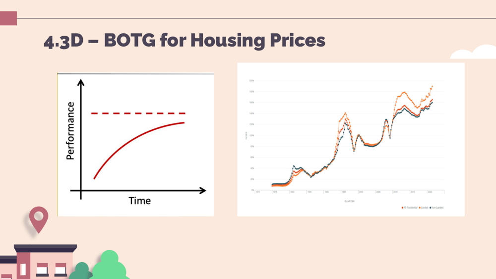
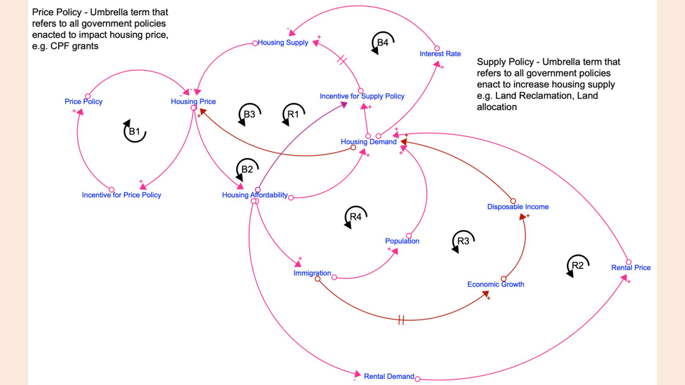
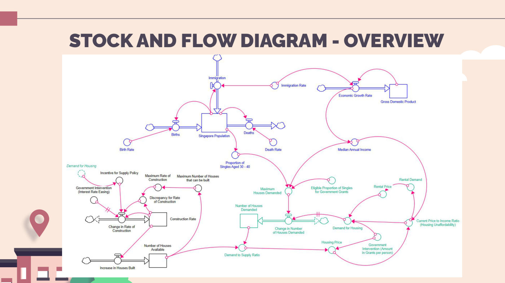
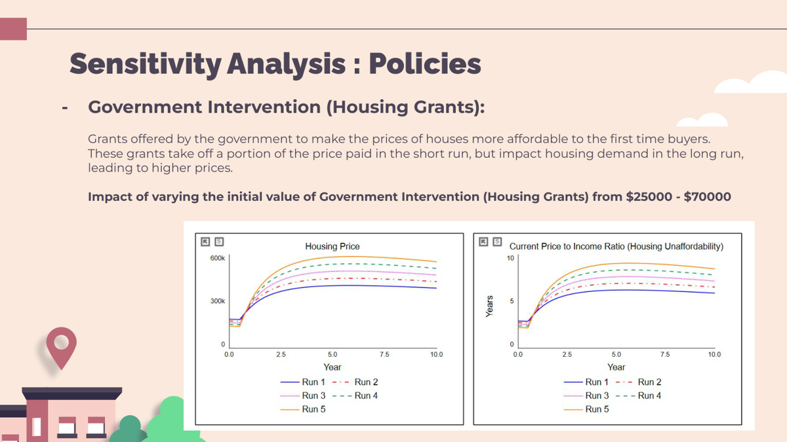

# Singapore Housing: a System Dynamics Model

**Why do first-time buyers in Singapore keep facing higher housing prices?** 
A systems-thinking study of Singapore's housing market from 2003 to 2033: behaviour-over-time
graphs, a causal loop diagram with eight feedback loops, a stock-and-flow simulation model in
Stella Architect, and policy tests on grants, interest rates and construction. For NUS IE2141
*Systems Thinking and Dynamics*.

> [!NOTE]
> This consolidated README page was added by
> [Claude Opus 5.5](https://docs.anthropic.com/en/docs/claude-code) in Nov 2026 using my
> [agentic-repo-analysis](https://github.com/sp4ce-cowboy/agentic-workflows) skill, from the
> team's models and final presentation. The project itself is from Oct – Nov 2023.

## At a glance

| | |
|---|---|
| **Question** | Housing prices in Singapore have risen steeply since 2003, and supply is expected to fall well short of demand by 2033. What structure drives this, and which policies would make homes affordable for first-time buyers? |
| **Context** | NUS [IE2141](https://nusmods.com/courses/IE2141/systems-thinking-and-dynamics) *Systems Thinking and Dynamics*, AY2023/24 Semester 1, team of 5 |
| **My role** | Key variables and behaviour-over-time graphs, and the causal loop diagram with its feedback loops |
| **Model** | 5 stocks, 7 flows and 19 converters, simulated in years with Euler integration |
| **Files** | [Stella models](models) · [final presentation](docs/final-presentation.pdf) (70 slides) |

## Behaviour over time

Four key variables over 2003 – 2033, each with its reference mode:

| Variable | Behaviour | Why |
|---|---|---|
| Population | Steady increase | Growth moderated by immigration policy, not exponential: land, jobs and resources are scarce |
| Housing demand | Steady increase | Tied to population, since housing is an essential good |
| Housing supply | Goal-seeking increase | Construction rises towards a target and slows as it approaches it |
| Housing prices | Goal-seeking increase | Demand outpaces supply, which land scarcity limits |

## Causal loop diagram

Two subsystems, joined through demand:

| Loop | Type | Path |
|---|---|---|
| B1 | Balancing | Housing price → incentive for price policy → price policy → lower housing price |
| B2 | Balancing | Housing price → lower affordability → lower demand → lower price |
| B3 | Balancing | Demand → incentive for supply policy → supply (long delay) → lower price |
| B4 | Balancing | Demand → interest rates → less supply → higher price → lower affordability → lower demand |
| R1 | Reinforcing | Supply → lower price → affordability → demand → incentive for supply → more supply |
| R2 | Reinforcing | Rental demand → rental price → housing demand → price → lower affordability → more rental demand |
| R3 | Reinforcing | Economic growth → disposable income → demand → supply incentive → supply |
| R4 | Reinforcing | Immigration → population → demand → supply → lower price → affordability → immigration |

- **Engines of growth:** R4 drives population and, through it, demand.
- **Stabilisers:** B3 and B4 make supply goal-seeking; long construction delays make the price
  response lag behind demand.
- **The problem in one line:** population → demand → supply and price, with supply and price policy
  reacting to each. Every variable feeds affordability, so no single lever fixes it.

## Stock-and-flow model

- **Stocks:** Singapore population, gross domestic product, construction rate, houses available
  and houses demanded.
- **Flows and equations:** births, deaths and immigration proportional to population; economic
  growth from GDP; a construction pipeline in which 10% of started projects finish each year; demand
  for housing from rent, grants and the price-to-income ratio; government interventions with delays.
- **Verification and validation:** the model was checked against historical data and the
  behaviour-over-time graphs ([presentation](docs/final-presentation.pdf), section 7).

## Policy tests

Sensitivity runs on four levers:

| Policy | Range tested |
|---|---|
| Housing grants for first-time buyers | S$25,000 – 70,000 |
| Interest rate easing | 0.1 – 0.5 |
| Construction rate (faster building) | 10,000 – 85,000 homes |
| Share of singles aged 30 – 40 eligible for grants | 0.075 – 0.1 |

- **Finding:** grants lower the price a buyer pays in the short run, but raise demand and therefore
  prices in the long run.
- **Leverage proposed:** widen grant eligibility for low-income singles (a lower income ceiling,
  and eligibility below age 35).

## Skills covered

| Skill | Where it shows | Docs |
|---|---|---|
| **Systems thinking** | Behaviour-over-time graphs, reference modes and a causal loop diagram with eight named loops | |
| **System dynamics modelling**  | Stocks, flows, converters, delays and equations: [`models`](models) | [Stella Architect](https://www.iseesystems.com/store/products/stella-architect.aspx) |
| **Policy analysis** | Sensitivity runs and leverage points | |

## On my resume

**Skills:** systems thinking · system dynamics · causal loop diagrams · stock-and-flow modelling · Stella Architect · sensitivity analysis · policy analysis

- Modelled Singapore's housing market from 2003 to 2033 in a team of 5 with system dynamics: behaviour-over-time graphs, a causal loop diagram with eight feedback loops and a stock-and-flow simulation in Stella Architect (5 stocks, 7 flows, 19 converters).
- Built the causal loop diagram: four balancing and four reinforcing loops across housing and socio-economic subsystems, tying the growth in population and demand to goal-seeking supply and prices.
- Defined the key variables and their reference modes over 30 years, and related each pattern to the loops that drive it.
- Tested housing grants, interest rate easing and construction speed in sensitivity runs, showing that grants raise prices in the long run, and proposed widening grant eligibility as a lever.

## Getting started

Open the `.stmx` files in [Stella Architect](https://www.iseesystems.com/store/products/stella-architect.aspx)
or Stella Online, then run the stock-and-flow model.
